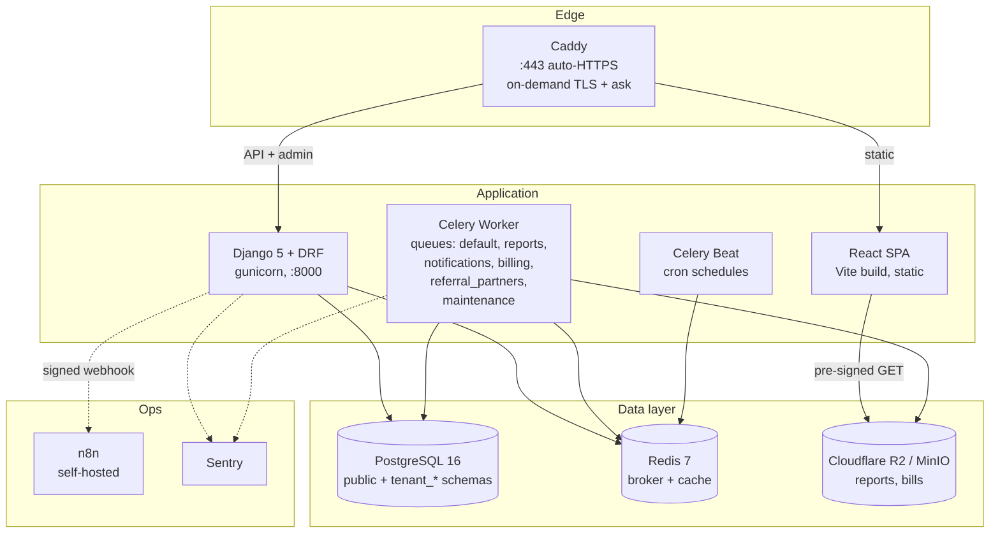

# LabFlow


**LabFlow** is a comprehensive, multi-tenant SaaS platform engineered specifically for diagnostic laboratories in Pakistan. It modernizes lab operations by providing end-to-end management of patient workflows, multi-branch setups, automated communications, and complex revenue-sharing agreements.

Designed for both robust scale and strict data isolation, LabFlow provides lab owners, medical staff, and referring partners with a secure, highly available, and intuitive system.

---

## 🏗 High-Level Architecture

LabFlow utilizes a modular monolith architectural pattern, backed by a robust and scalable open-source stack. The platform strongly enforces multi-tenancy at the database level using a PostgreSQL schema-per-tenant isolation model.

### Container Diagram



### Technology Stack

* **Frontend:** React 18, TypeScript, Vite, Tailwind CSS (SPA)
* **Backend:** Django 5, Django REST Framework (DRF), `django-tenants`
* **Database:** PostgreSQL 16
* **Cache & Message Broker:** Redis 7
* **Task Queues:** Celery & Celery Beat
* **Automation Layer:** n8n (Self-hosted)
* **Storage:** S3-compatible Object Storage (Cloudflare R2 / MinIO)
* **Infrastructure:** Docker Compose, Caddy (Reverse Proxy with auto-TLS)

---

## ✨ Key Features

* **Strict Multi-Tenancy:** Each laboratory operates in complete data isolation via a dedicated PostgreSQL schema (`tenant_<uuid>`), virtually eliminating cross-tenant data leaks.
* **Multi-Branch Operations:** Centralized management of complex multi-branch setups, allowing seamless sample transfers and staff assignments across locations.
* **Intelligent Revenue-Sharing:** Automated calculation of commissions for referral partners based on customizable ledgers and monthly statement fan-outs.
* **Integrated Automation (n8n):** A decoupled workflow automation engine that handles external communications (WhatsApp, Email) via signed webhooks, keeping the core API highly responsive.
* **Granular Role-Based Access Control (RBAC):** Tailored views and permissions for Receptionists, Technicians, Pathologists, Branch Managers, and Super Admins.
* **PDF Report Generation:** Robust asynchronous generation of diagnostic reports and billing statements securely stored and delivered via pre-signed URLs.

---

## 📂 Repository Structure

The project is organized as a monorepo to streamline development and continuous integration.

```text
labflow/
  backend/            Django 5 + DRF + django-tenants (PostgreSQL schema-per-tenant)
  frontend/           React 18 + TypeScript + Vite + Tailwind CSS SPA
  infra/              Docker Compose, Caddyfile, and deployment scripts
  n8n/workflows/      Self-hosted automation and communication workflows
  docs/               Authoritative engineering specifications (Docs 01–10)
  .github/workflows/  Continuous Integration pipelines
  Makefile            Standard developer interface
  .env.example        Environment variable template
  .editorconfig       Formatting and indentation rules
  .gitignore          Repository hygiene and secret exclusion
```

---

## 📚 Documentation Index

The `docs/` directory contains the authoritative engineering specifications for LabFlow. Developers and stakeholders should reference these HTML documents for deep dives into specific subsystems.

| Document | Description |
| :--- | :--- |
| **Doc 01: Architecture Overview** | System summary, modular monolith design, multi-tenancy, and high-level data flows. |
| **Doc 02: Database Schema** | PostgreSQL schema layout, append-only policies, and entity relationships. |
| **Doc 03: Core Lab Modules** | Patient registration, testing workflows, PDF specifications, and TAT observability. |
| **Doc 04: Multi-Branch & Tenancy** | Tenant lifecycle, request resolution, limits, and multi-branch data boundaries. |
| **Doc 05: Revenue-Share Module** | Ledger management, referral partner rules, and automated monthly settlements. |
| **Doc 06: Automation Layer (n8n)** | Trust boundaries, webhook contracts, and external communication pipelines. |
| **Doc 07: Frontend Architecture** | React SPA routing, data fetching, role-based gates, and i18n considerations. |
| **Doc 08: Security & Cross-Cutting** | Authentication, authorization, CSRF/CORS, audit logging, and threat models. |
| **Doc 09: Development Guidelines** | Coding standards, CI pipelines, local environments, and PR workflows. |
| **Doc 10: Delivery Plan** | Infrastructure sizing, deployment procedures, launch costing, and capacity planning. |

---

## 🛠 Developer Guidelines & Local Setup

All routine development tasks are managed via `make`.

### Prerequisites
* Docker and Docker Compose
* Node.js (for local frontend tooling)
* Python 3.12+ (for local backend tooling)

### Quick Start

1. **Clone the repository:**
   ```bash
   git clone https://github.com/your-org/labflow.git
   cd labflow
   ```

2. **Configure Environment:**
   Copy the example environment template and populate your local secrets.
   ```bash
   cp .env.example .env
   ```

3. **Start the Environment:**
   Boot up the PostgreSQL database, Redis, Caddy, backend API, and frontend SPA.
   ```bash
   make up
   ```

4. **Run Migrations & Seed Data:**
   Initialize schemas and populate the demo tenant with synthetic fixtures for testing.
   ```bash
   make migrate
   make seed
   ```

### Common Developer Commands

- `make up`: Start local environment via Docker Compose.
- `make down`: Stop local environment.
- `make test`: Run backend and frontend test suites.
- `make test-e2e`: Run Playwright end-to-end tests.
- `make lint`: Run Ruff, mypy, ESLint, and Prettier checks.
- `make types`: Regenerate OpenAPI schemas and TypeScript types.
- `make migrate`: Apply database migrations across schemas.

---

## 🛑 Core Principles

1. **No Application Code in Root:** Repository structure and hygiene only. All application code must live in `backend/`, `frontend/`, or `n8n/`.
2. **Zero Secrets Committed:** Credentials exist strictly in host environment files (`.env`). Never hardcode secrets.
3. **Schema-Per-Tenant Isolation:** Database isolation is strictly enforced at the PostgreSQL schema level. Cross-tenant queries are forbidden by design.

